## task 01

首先是进入workspace目录查看文件
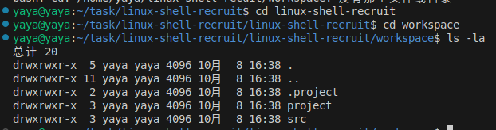
> -a参数可以查看隐藏文件（.开头文件）

用grep递归搜索并显示文件
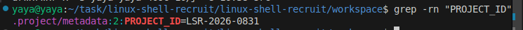

然后就写入编号
先回到根目录（包含outputs）
然后使用echo写入（也可以用sprinf）

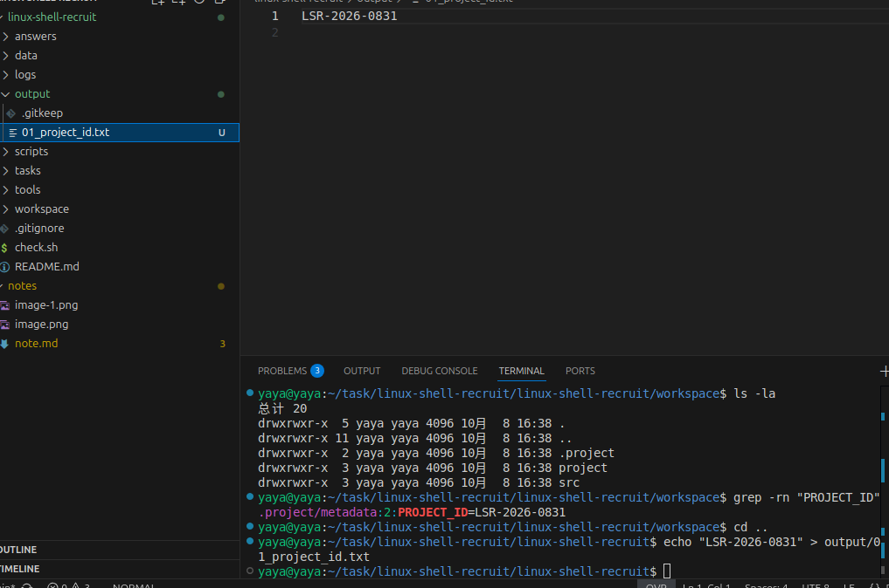
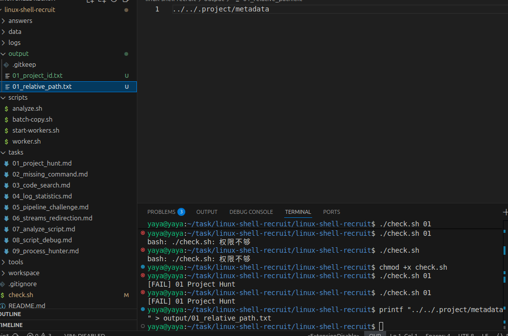

## task 02

### 1
不可以执行一般是因为没有权限
我们先查看一下权限

> 可以看到没有执行-x，加上就行

使用chmod加上权限
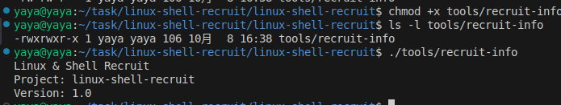

### 2
见answer/02.md

### 3
把tools/目录临时加进当前shell的PATH
> 就是环境变量配置，shell直接查找的地方
使用export让变量对shell及其子程序生效
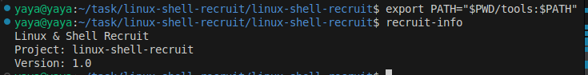
用command -v可以查看ls解析路径

## task 03

还是先进入目录并确认文件
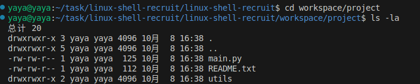

用find和grep找出匹配文件
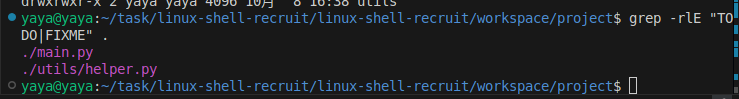
> grep -r会递归查找内容，-l只输出文件名，-E支持正则（TODO|FIAME是正则表示）

拼接一下，用find找出并写入文件
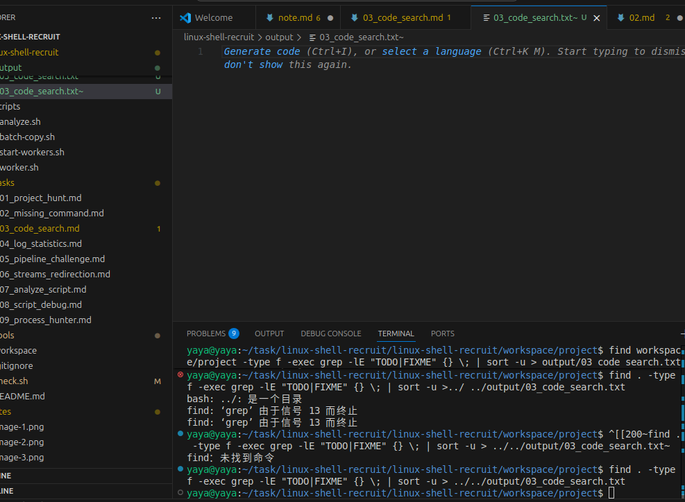
> sort -u是去重

## task 04

先看一眼日志格式
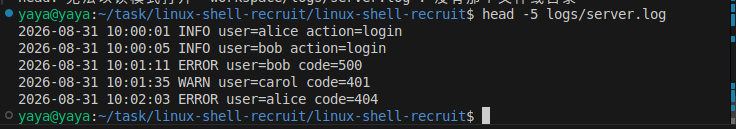

### 1

统计ERROR的日志数量
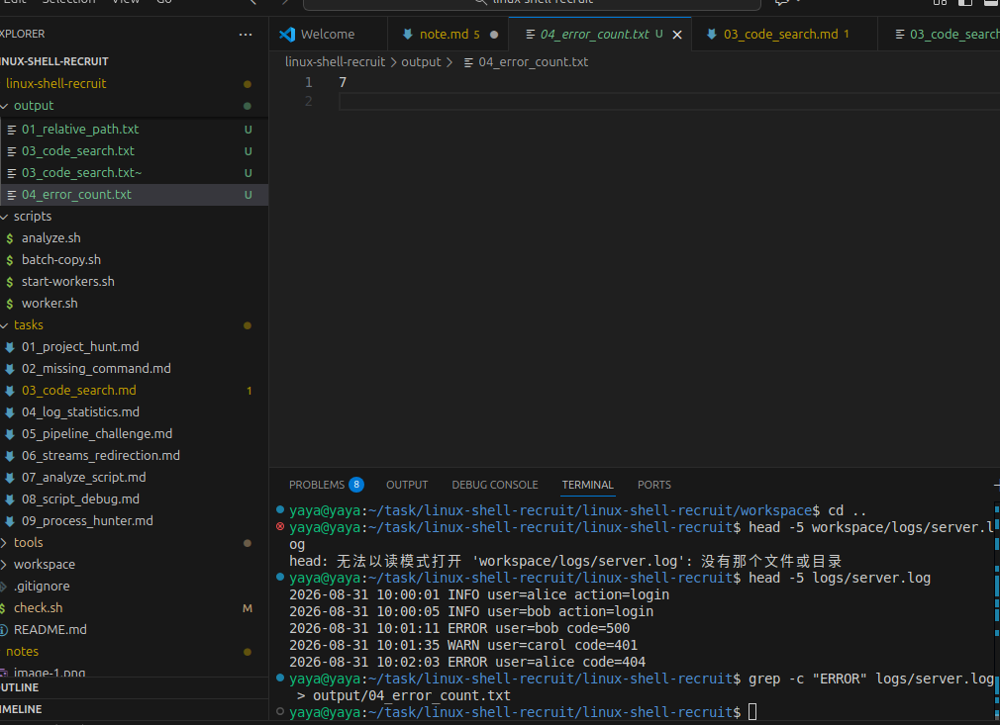
> grep -c用来统计数量

### 2

查找所有ERROR日志的用户名
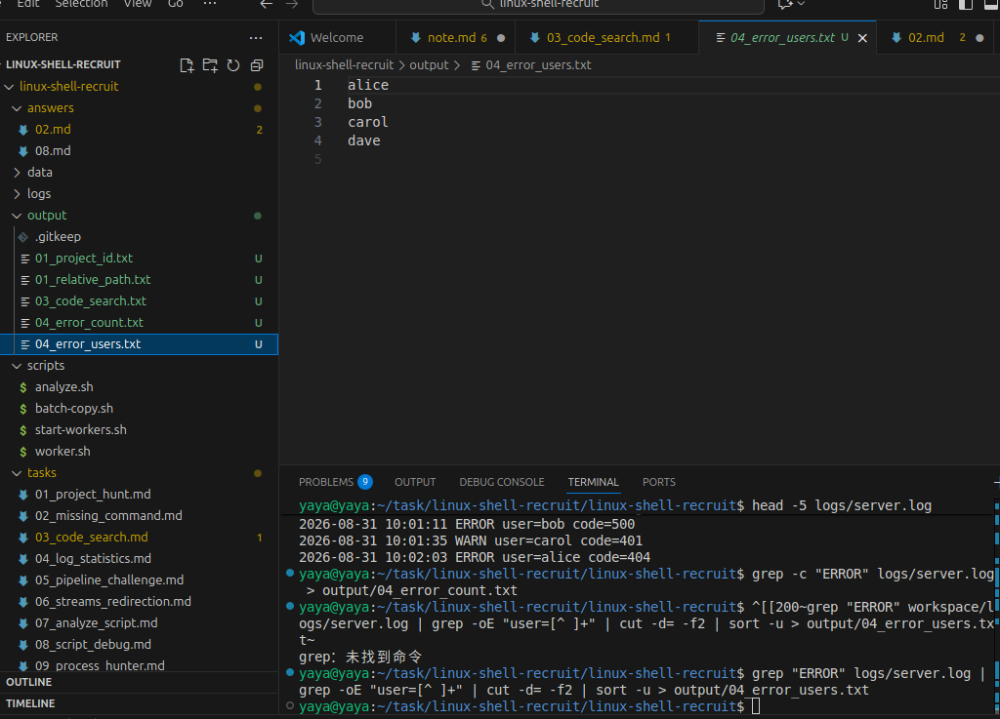
> grep "ERROR"：只看ERROR行。
> grep -oE "user=[^ ]+"：只提取user=xxx这一段
> cut -d= -f2：以=分隔，取第二部分，即用户名

### 3

找出出现次数最多的错误码
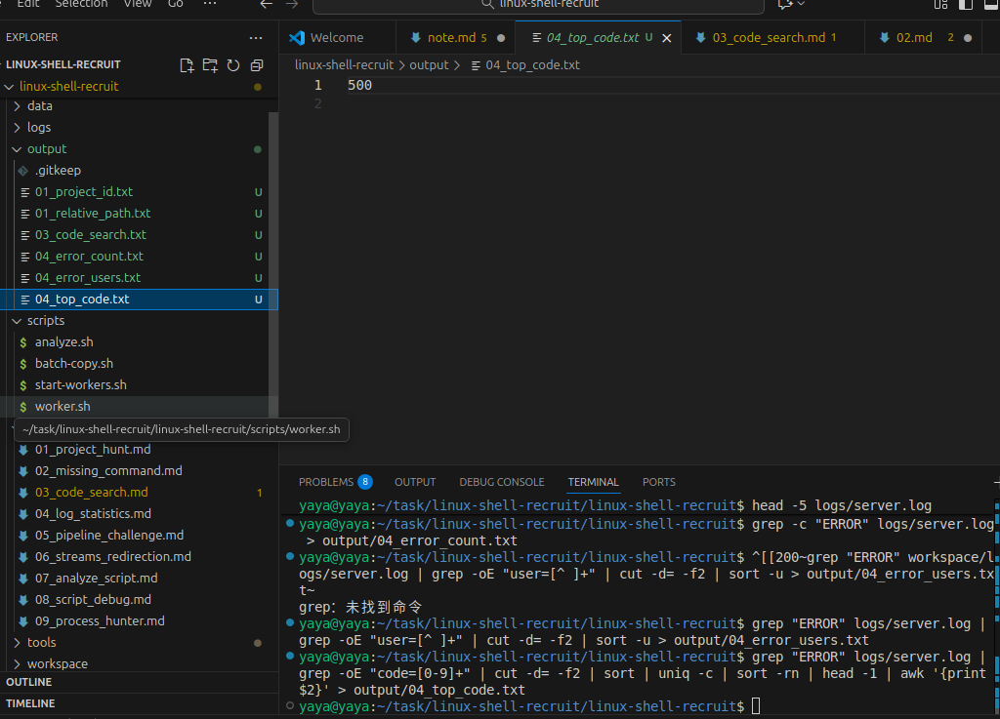
> grep -oE "code=[0-9]+"：提取code=数字
> cut -d= -f2：只留数字
> sort | uniq -c：统计每个错误码出现次数
> sort -rn：按次数从大到小排序
> head -1：取第一行（次数最多）
> awk '{print $2}'：只输出错误码本身，不要次数

## task 05

依旧先看一眼日志格式
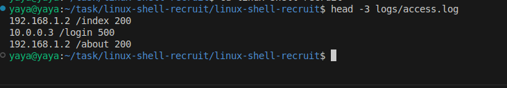
可以看到ip地址在第一列,并且是空格分隔的

就可以根据格式找请求次数最多的ip
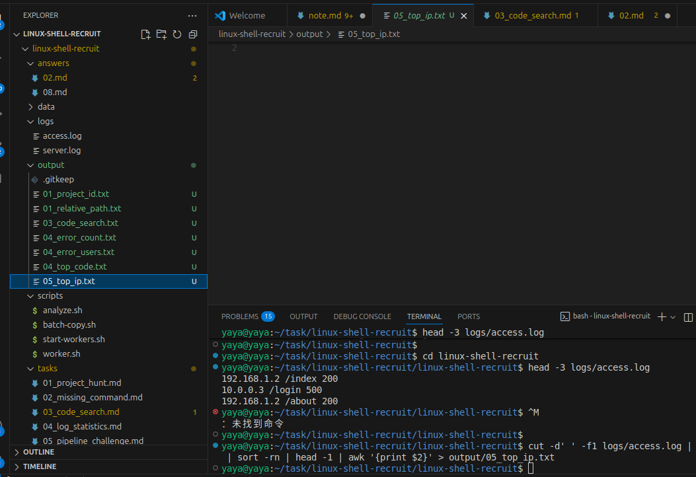
> cut -d' ' -f1: 按空格分隔，取第1列(ip)
> sort | uniq -c: 先排序,再统计每个ip出现次数，格式：次数 ip
> sort -rn: 按次数从大到小排序
> head -1: 取次数最多的那行
> awk '{print $2}': 只输出ip（第 2 列），丢掉次数

## task 06

直接运行一下
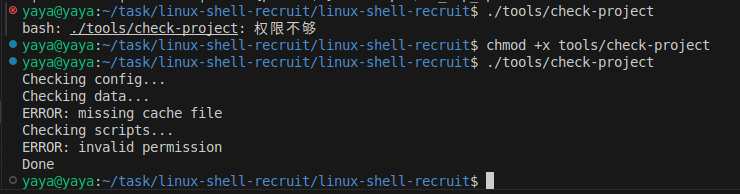
可以看到所有信息是混在一起的

### 1
保存stdout到txt,stderr打印到终端
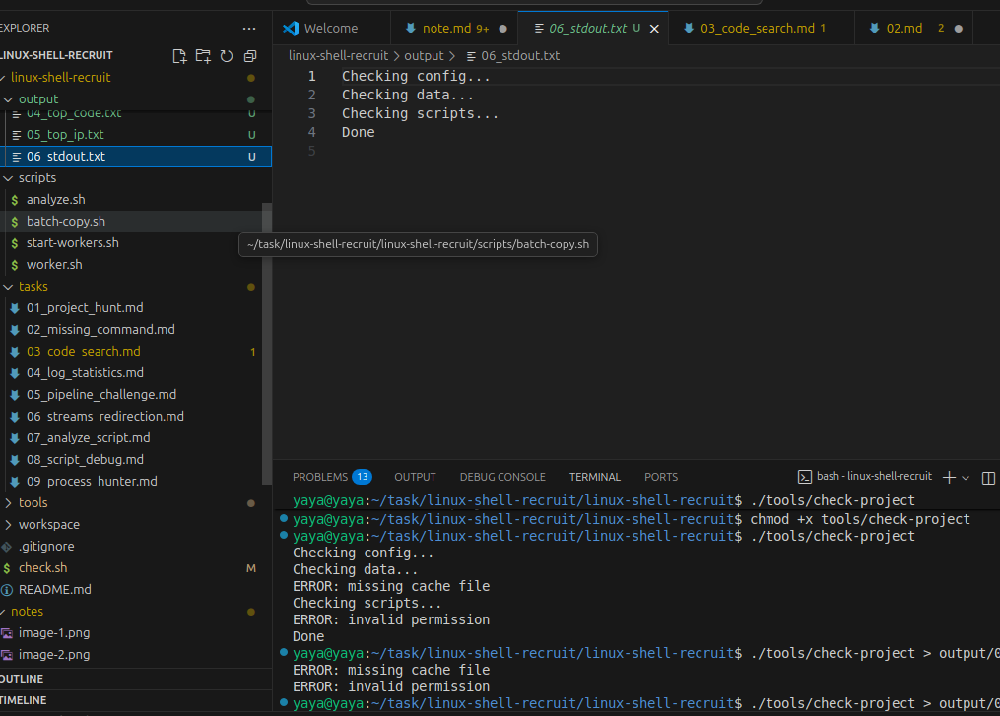
> \> 只重定向stdout（文件描述符1）

### 2
保存stderr到txt,stdout打印到终端
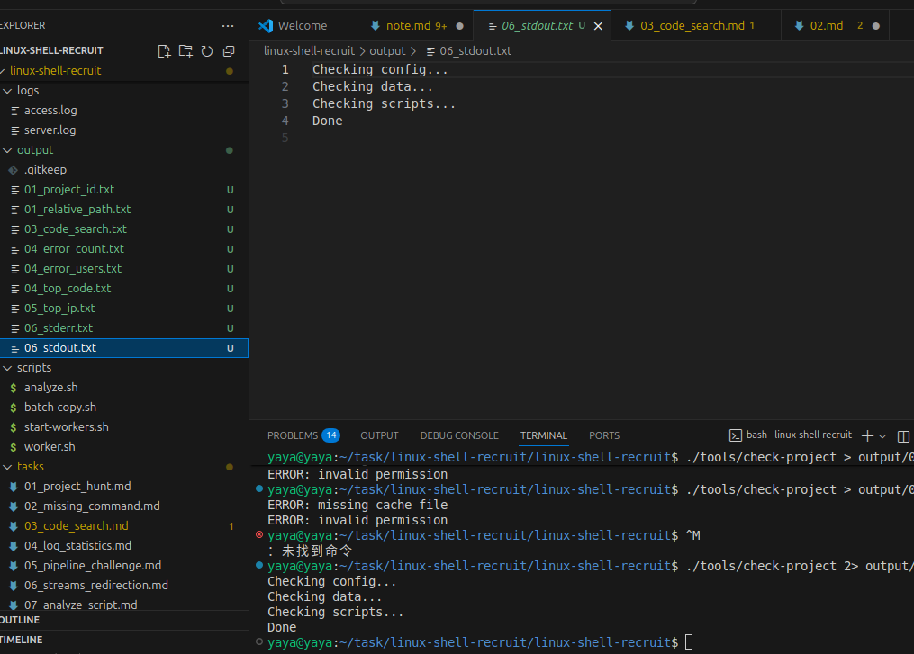
> 2>重定向stderr（文件描述符2）

### 3
用tee把stdin同时写到文件和stdout（终端）
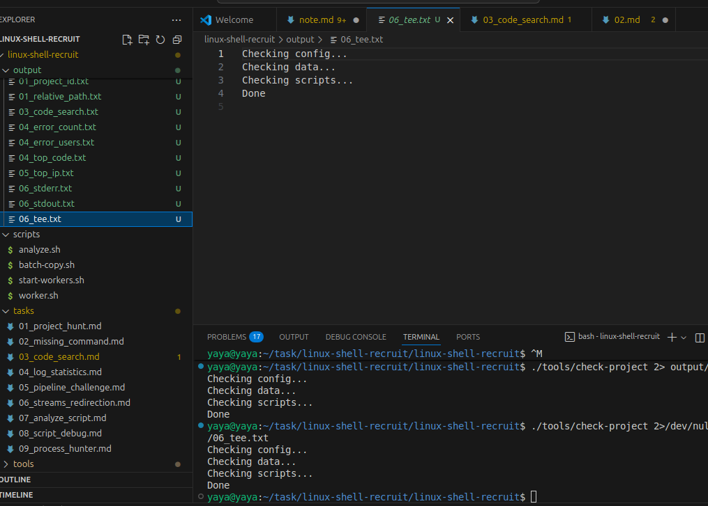
> 2>/dev/null把stderr丢掉，避免混进tee的内容

## task 07
写一个scripts/analyze.sh的脚本

创建一个脚本并编辑，给它执行的权限
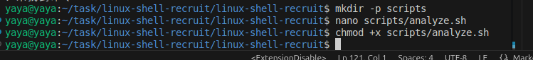

脚本内容：
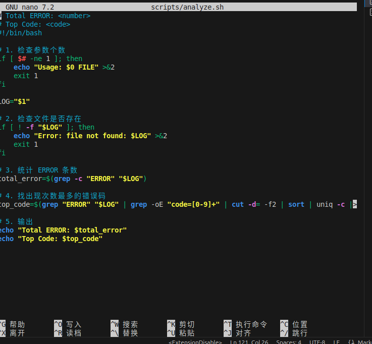
> $#: 命令行参数个数
> $1: 第一个参数
> [ $# -ne 1 ]: 参数不等于1
> [ ! -f "$LOG" ]: 文件不存在
> \>&2:错误信息输出到stderr
> exit 1: 非零退出（表示失败）
> exit 0: 成功退出（可省略，脚本自然结束就是0）

测试一下效果
无参数：Usage+1退出
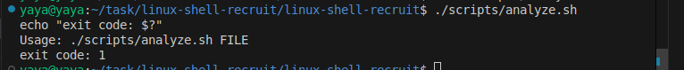

文件不存在：报错+1退出
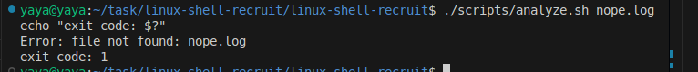

正常
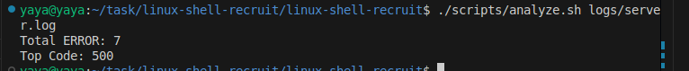

## task 08

修复scripts/batch-copy.sh脚本
先看看原脚本
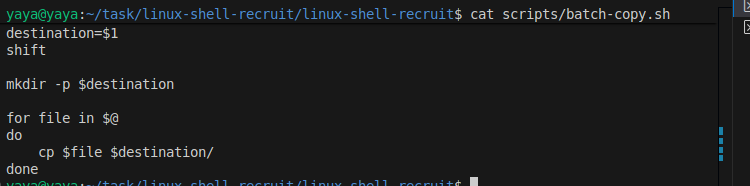

> 把脚本第一个参数传到destination文件夹里
> shift整体左移一位，相当于删掉第一个参数
> 创建destination文件夹
> 依次取出文件名，放入file
> 把file复制到destination里面

**如果一个文件名中有空格就会被认定为两个**

对所有使用通配符的变量加上""就可以了
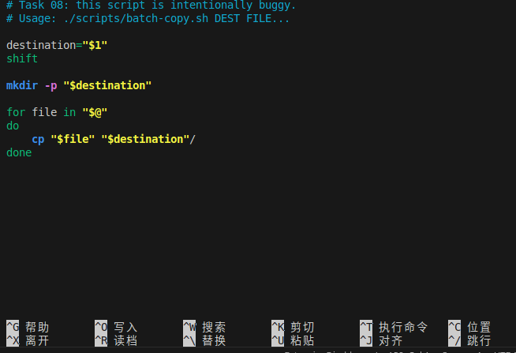
> "$@": 每个参数作为独立整体，空格不拆分
> "$f": 变量加引号，保留空格
> shift: 把第一个参数（目标目录）移出，剩下的才是文件列表

测试效果：
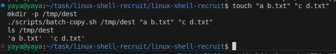
正确的

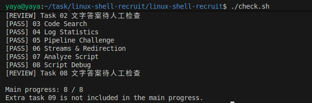

## task 09

首先启动workers并查看进程
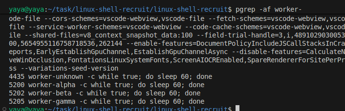

找到worker-beta的PID并结束进程
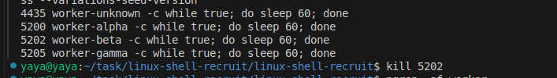

> ps aux / ps -ef: 列出所有进程
> pgrep -af 名字: 按名字找 PID，显示命令行
> kill PID: 向指定进程发信号终止（默认TERM）
> pkill -f 名字：按命令行模式杀进程
> kill -9 PID： 强制杀（最后手段）
> &： 后台运行
> jobs： 查看当前Shell的后台任务

